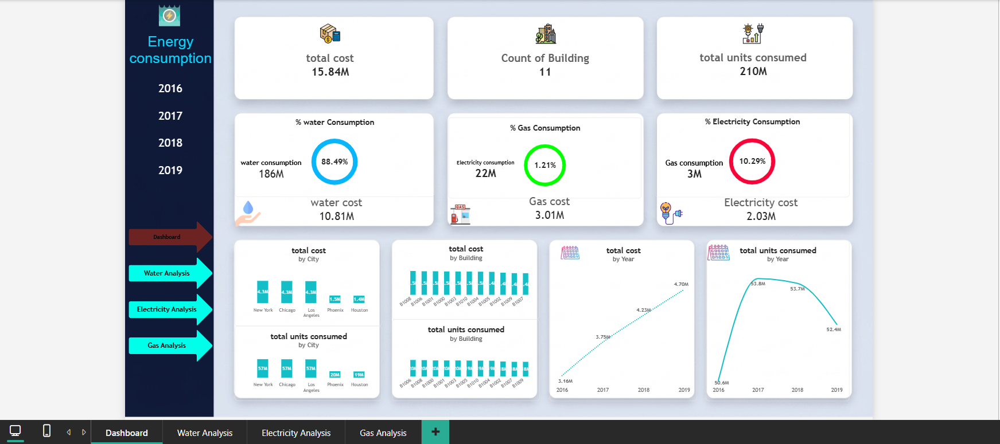
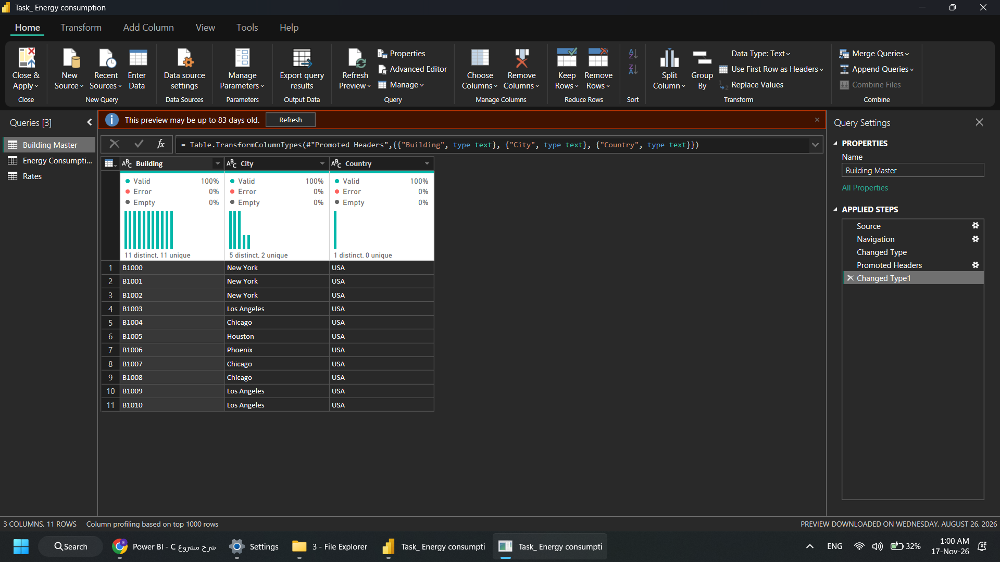
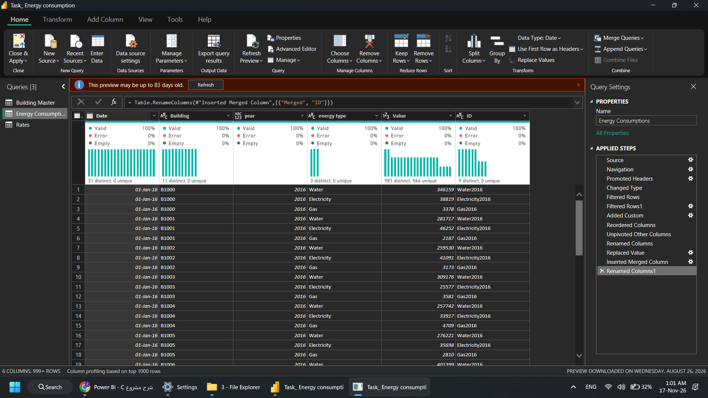
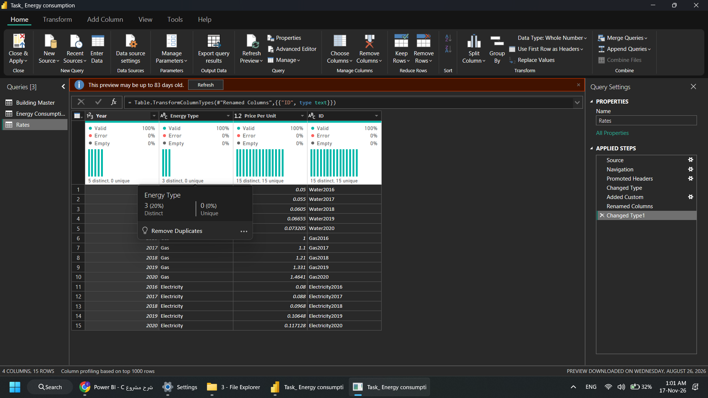
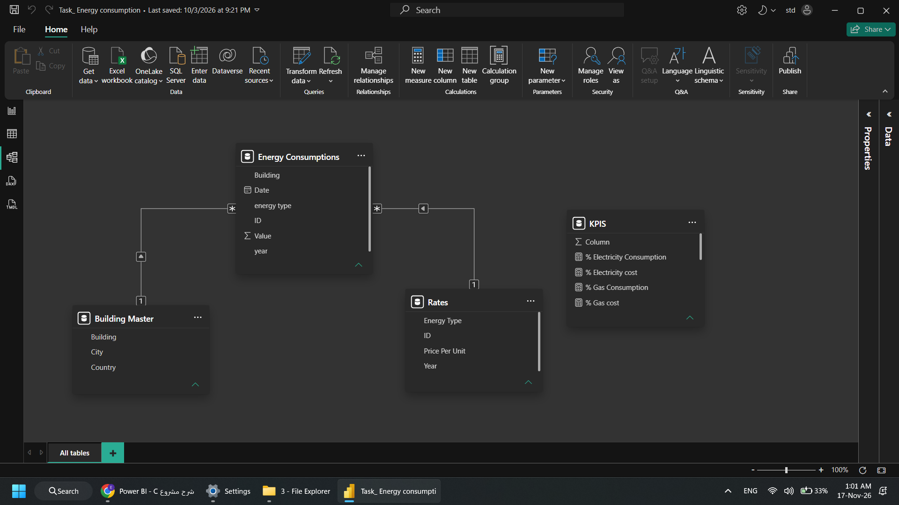
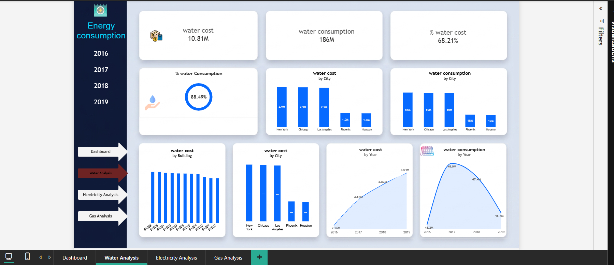
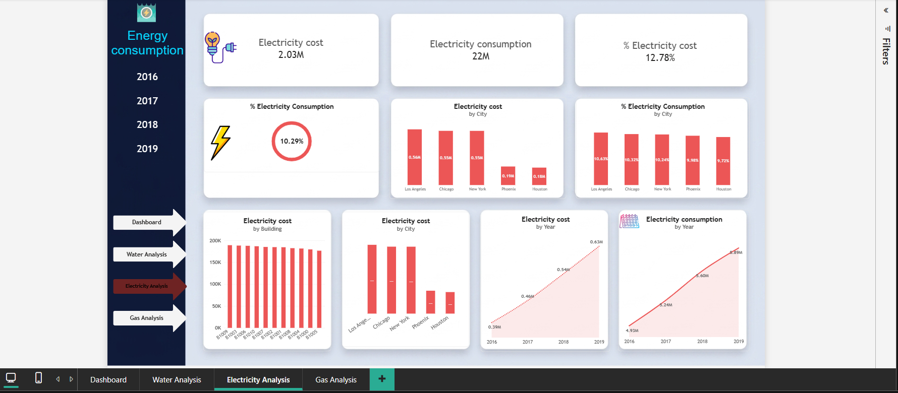
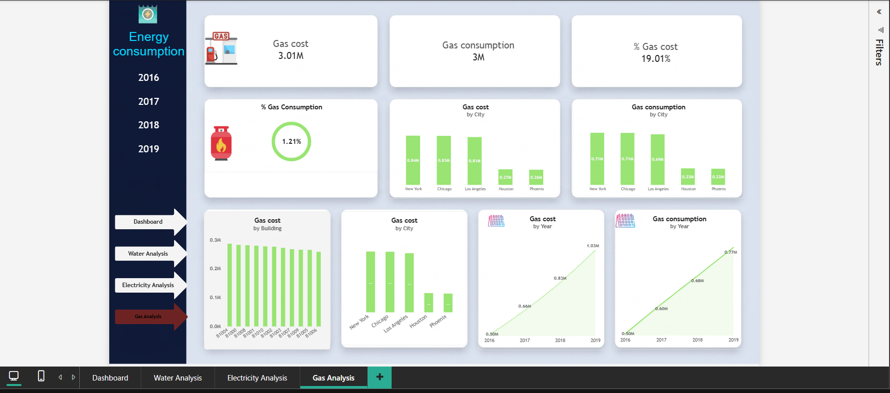

# ⚡ Energy Consumption Dashboard (Power BI)

An interactive, multi-page Power BI report that tracks **water, electricity and gas** consumption and cost across **11 buildings in 5 US cities** from **2016 to 2019**. It turns raw utility data into a clear picture of where the money goes, which city and building drive it, and how usage and cost move over time.



---

## 📌 Business Questions Answered

1. How much does the portfolio spend on utilities, and how many units does it consume?
2. Which utility (water, electricity, gas) drives **cost** versus **volume**?
3. Which cities and buildings consume and spend the most?
4. How have cost and consumption changed from 2016 to 2019?

---

## 🧰 Tools & Skills

| Area | Details |
|------|---------|
| Tool | Power BI Desktop |
| Data cleaning | Power Query (unpivot, merged key column, filtering, type changes) |
| Data modeling | 3 tables + a measures table, one-to-many relationships |
| DAX | Measures for cost, consumption and percentage-of-total KPIs |
| Visualization | KPI cards, donut charts, clustered column charts, line/area charts, slicer |
| UX / Design | Custom dark navigation panel, page-navigator buttons, custom icons, consistent color per utility |

---

## 🧹 Data Cleaning & Transformation (Power Query)

The report loads **three queries** in Power Query. Below are the applied steps exactly as they appear in the Query Editor.

### 1. `Building Master`


**Applied steps:** Source → Navigation → Changed Type → Promoted Headers → Changed Type

**Result:** 3 text columns (`Building`, `City`, `Country`), **11 rows** – 11 unique buildings in **5 cities** (New York, Los Angeles, Chicago, Houston, Phoenix), all in the USA. Column profiling shows 100% valid, 0% errors, 0% empty.

### 2. `Energy Consumptions`


**Applied steps:** Source → Navigation → Promoted Headers → Changed Type → Filtered Rows → Filtered Rows → Added Custom → Reordered Columns → **Unpivoted Other Columns** → Renamed Columns → Replaced Value → **Inserted Merged Column** → Renamed Columns (`Merged` → `ID`)

**Result:** a clean, analysis-ready table with 6 columns – `Date`, `Building`, `year`, `energy type`, `Value`, `ID`:
- The **unpivot** turns the separate utility columns into one row per building, per date, per energy type (Water / Electricity / Gas) with a single `Value` column. Example: building B1000 on 01-Jan-16 has one Water row, one Electricity row and one Gas row.
- The **merged `ID` column** combines the energy type and the year (for example `Water2016`, `Gas2016`). It is the key used to look up the price in the `Rates` table.
- Column profiling shows 100% valid, 0% errors, 0% empty (profiling is based on the top 1,000 rows).

### 3. `Rates`


**Applied steps:** Source → Navigation → Promoted Headers → Changed Type → Added Custom → Renamed Columns → Changed Type

**Result:** 4 columns (`Year`, `Energy Type`, `Price Per Unit`, `ID`) and **15 rows** = 3 energy types × 5 years (2016–2020). `ID` has 15 unique values (for example `Water2016`), so each row is one price for one energy type in one year.

| Energy type | 2016 | 2017 | 2018 | 2019 | 2020 |
|-------------|------|------|------|------|------|
| Water | 0.05 | 0.055 | 0.0605 | 0.06655 | 0.073205 |
| Electricity | 0.08 | 0.088 | 0.0968 | 0.10648 | 0.117128 |
| Gas | 1 | 1.1 | 1.21 | 1.331 | 1.4641 |

The price per unit increases by **10% every year** for all three utilities.

<!-- TODO (Eslam): add the original data source (file type / where the data came from). -->

---

## 🗂️ Data Model



The model has four tables:

| Table | Role |
|-------|------|
| **Energy Consumptions** | Main table – consumption `Value` per building, date and energy type |
| **Building Master** | Lookup table – building and its `City` / `Country` |
| **Rates** | Lookup table – `Price Per Unit` per energy type and year |
| **KPIS** | Measures table – holds the measures used in the report (cost, consumption and % of total) |

**Relationships (from the model view):**
- `Building Master` (**1**) → `Energy Consumptions` (**many**) – connects each reading to its building and city (via `Building`).
- `Rates` (**1**) → `Energy Consumptions` (**many**) – connects each reading to its price (via the `ID` key, e.g. `Water2016`).
- Both relationships are one-to-many with a single filter direction, from the lookup table to `Energy Consumptions`.
- `KPIS` is a stand-alone measures table with no relationships.

**How cost is calculated:** the cost figures in the report reconcile exactly with **consumption × price per unit** (for example 2016 water: 45.2M units × 0.05 = 2.26M, and 2019 gas: 0.77M units × 1.331 = 1.03M).

<!-- TODO (Eslam): optionally paste 2-3 of your real DAX measures here. -->

---

## 📊 Report Pages

The report has **4 pages**, each with the same layout so it is easy to compare utilities. A left-hand navigation panel and a **Year slicer (2016–2019)** are available on every page.

### 1. Dashboard (Overview)
- KPI cards: **Total cost**, **Count of buildings**, **Total units consumed**
- Share of each utility (water / gas / electricity) in donut charts, with its cost
- Total cost and total units **by city**, **by building** and **by year**

### 2. Water Analysis


### 3. Electricity Analysis


### 4. Gas Analysis


Each utility page shows: cost, consumption, % of total cost, % of total consumption, cost and consumption **by city**, cost **by building**, and cost and consumption **by year**.

---

## 🔍 Key Insights

| Metric | Value |
|--------|-------|
| Total utility cost | **15.84M** |
| Total units consumed | **210M** |
| Buildings | **11** |
| Cities | **5** (New York, Chicago, Los Angeles, Phoenix, Houston) |

**By utility**

| Utility | Units | Share of units | Cost | Share of cost |
|---------|-------|----------------|------|---------------|
| Water | 186M | 88.49% | 10.81M | 68.21% |
| Electricity | 22M | 10.29% | 2.03M | 12.78% |
| Gas | 3M | 1.21% | 3.01M | 19.01% |

1. **Water dominates both volume and cost** – about 88% of all units and 68% of total spend.
2. **Gas is the most expensive per unit** – it is only ~1% of units but ~19% of cost, so it is the best candidate for efficiency or tariff review.
3. **Three cities drive the spend** – New York, Chicago and Los Angeles each cost about 4.3M (and consume about 57M units each), far above Phoenix (1.5M) and Houston (1.4M).
4. **Cost is rising faster than usage** – total cost grew from about 3.16M (2016) to 4.70M (2019), roughly +49%, while total units stayed nearly flat (about 50.6M to 52.4M). The `Rates` table explains most of this: the price per unit rises 10% every year (about +33% from 2016 to 2019), and gas and electricity usage – the more expensive utilities per unit – grew over the same period.
5. **Electricity and gas consumption trend upward every year**, while water consumption peaks in 2017 and then declines slightly.
6. **Buildings look evenly spread** – the cost-by-building charts show bars of similar height across the 11 buildings, while the differences between cities are much larger.

> Figures are read from the report visuals; open the `.pbix` and use the Year slicer to explore any single year.

---

## 💡 Suggested Next Steps

These are suggestions based on the numbers above, not results from the report.

- Review the **gas** contracts and usage first – highest cost per unit.
- Set a water-saving target for the three high-cost cities (New York, Chicago, Los Angeles).
- Plan for the 10% yearly price increase – at flat consumption, cost still grows every year.
- Track electricity growth year over year and look for efficiency measures.

---

## 🛠️ What I Built

- **Cleaned the data in Power Query** – 3 queries with typed columns, filtering, an **unpivot** to reshape the utility data, and a merged **`ID` key** (energy type + year).
- **Built the data model** – two one-to-many relationships (Building Master → Energy Consumptions, Rates → Energy Consumptions) plus a dedicated `KPIS` measures table.
- **Created the measures** for cost, consumption and percentage of total.
- **Designed a 4-page report** (Dashboard, Water, Electricity, Gas) with the same layout on every page: KPI cards, donut charts, column charts by city and building, and line/area charts by year.
- Added a **Year slicer (2016–2019)**, a left-side **page navigator**, a consistent color per utility (blue = water, red = electricity, green = gas) and custom icons.

---

## 📁 Repository Structure

```
energy-consumption-dashboard/
├── Energy_Consumption.pbix     # Power BI report
├── README.md
└── images/
    ├── dashboard.png
    ├── water-analysis.png
    ├── electricity-analysis.png
    ├── gas-analysis.png
    ├── data-model.png
    ├── power-query-building-master.png
    ├── power-query-energy-consumptions.png
    └── power-query-rates.png
```

## ▶️ How to Use

1. Download `Energy_Consumption.pbix`.
2. Open it with **Power BI Desktop**.
3. Use the left panel to switch pages and the **year buttons (2016–2019)** to filter.

---

## 👤 Author

**Eslam Arafa** – Data Analyst
📧 arafaeslam2003@gmail.com
🔗 [LinkedIn](https://linkedin.com/in/eslam-m-arafa/) · [GitHub](https://github.com/EslamArafa2003)
